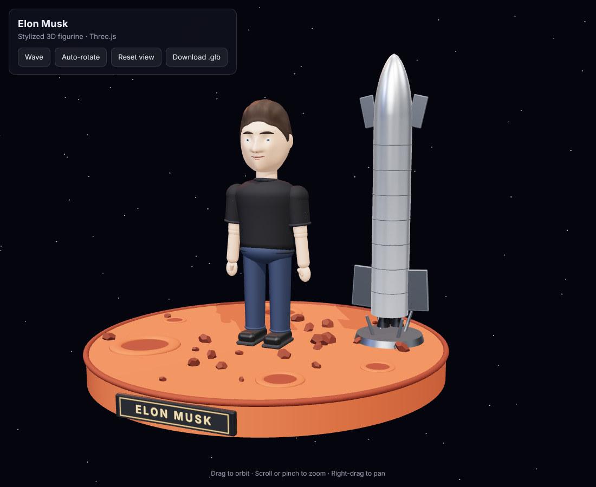

# Bruce-the-frist
Frist one

## Elon Musk 3D figure

A stylized, interactive 3D figurine of Elon Musk standing on a Mars-soil base
next to a stainless-steel rocket. The whole model is built in code with
[Three.js](https://threejs.org/), with no external mesh files.

### View it

Open `index.html` in a modern browser. It loads Three.js from the jsDelivr CDN,
so it needs an internet connection. You can also serve the folder, for example
with `npx serve .`, or enable GitHub Pages for the repository.

- Drag to orbit, scroll or pinch to zoom, right-drag to pan
- **Wave** makes the figure wave
- **Auto-rotate** turns the scene slowly
- **Download .glb** exports the model in its rest pose

### Model file

[`models/elon-musk.glb`](models/elon-musk.glb) is a ready-made export (glTF 2.0
binary, about 86k vertices, 23 materials). It opens in Blender, Unity, Unreal,
Windows 3D Viewer, or any glTF viewer. The meshes and materials are named
(`Hair`, `Face`, `Arm_R`, `Rocket`, `MarsBase`, and so on), so you can edit or
re-pose them.
