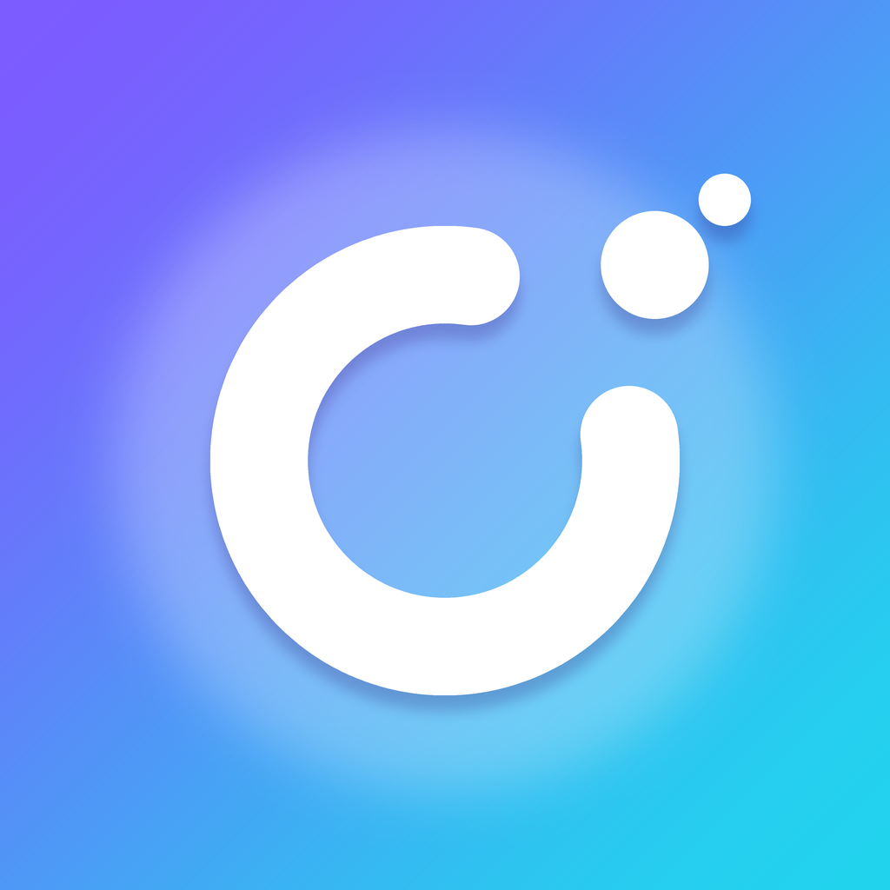

# Unhook: quit anything, one day at a time



**Unhook** is an iOS app that helps people break bad habits: smoking, vaping, alcohol, doomscrolling, sugar, porn, gambling, or anything else. It counts every second you stay free and shows the money and time you win back. When a craving hits, a 60-second SOS screen helps you ride it out.

It's built with SwiftUI and SwiftData. It needs no server, no account and no third-party libraries, and everything runs on the device.

---

## Why it could reach millions of users

| | |
|---|---|
| **Huge market** | Almost everyone has a habit they want to drop. One app covers every habit instead of one app per vice. |
| **Daily reason to open it** | A daily pledge with a mood check-in, a live streak counter, and money saved that ticks up every second. |
| **Built-in word of mouth** | Shareable progress cards ("I've been free from vaping for 30 days") spread the app on Instagram, TikTok and in group chats. |
| **Fast first win** | Milestones start at 1 hour and 12 hours, so new users unlock something in their first session. |
| **Trust** | 100% private and on-device, which matters for sensitive habits. Slips are handled kindly, so users come back instead of quitting the app. |
| **Room to make money** | Freemium: Unhook Pro could add unlimited habits, home-screen widgets, Live Activities, themes and iCloud sync (see the roadmap). |

## Features

- **Live streaks.** A big counter (days, hours, minutes, seconds) with a progress ring to the next milestone.
- **13 milestones**, from 1 hour to 5 years, plus milestone notifications.
- **Money, time and units saved**, e.g. "$312 saved · 2d 4h reclaimed · 360 cigarettes avoided".
- **SOS craving mode.** About 60 seconds of guided breathing (4-4-6) that shows *your own* reasons for quitting, then distraction ideas and a "craving crushed" celebration with confetti.
- **Daily pledge** with a mood check-in, a pledge streak and an optional daily reminder.
- **Kind relapse flow.** A slip resets the streak but never erases progress: earlier clean time still counts toward your totals, and your best streak is kept.
- **Progress tab** with lifetime totals, a cravings-beaten chart, a mood chart and 12 achievements.
- **Share cards** rendered as images, ready for social media.
- **14 one-tap presets** (smoking, vaping, alcohol, social media, sugar, caffeine, gambling…) with suggested reasons and default costs.
- **Settings** for currency, haptics, reminders, a helpline link and erase-all-data.
- **Light and dark mode**, haptics, VoiceOver labels and Dynamic Type-friendly layouts.

## Run it in Xcode

1. You need a Mac with **Xcode 16 or newer** (the app targets iOS 17+).
2. Open `Unhook.xcodeproj`.
3. Pick an iPhone simulator and press **⌘R**.

To run on your own iPhone:

1. Select the **Unhook** target, open **Signing & Capabilities**, and choose your **Team**.
2. Change the bundle identifier (`com.bruce.unhook`) to something unique, e.g. `com.yourname.unhook`.
3. Plug in your iPhone, select it as the run destination, and press **⌘R**.

Run the unit tests with **⌘U**. They use Swift Testing and cover milestones, savings math, relapses, streaks, achievements and formatting.

## Project structure

```
Unhook.xcodeproj           Xcode project (folders sync automatically, so new files are picked up)
Unhook/
  App/                     App entry point, root/tab navigation, preview sample data
  Models/                  SwiftData models (Habit, Relapse, Urge, Pledge) and pure logic
                           (milestones, achievements, streak math, presets, form draft)
  Services/                Notifications, haptics, settings keys
  Design/                  Colors and themes, formatters, button styles
  Views/
    Onboarding/            Four-page intro
    Home/                  Today tab: savings banner, pledge, habit cards, SOS button
    Habit/                 Habit detail: live hero, stats, milestones, history, slip and share sheets
    AddHabit/              Preset picker and add/edit form
    SOS/                   Guided breathing craving screen
    Insights/              Progress tab: totals, charts, achievements
    Settings/              Settings tab
    Components/            Card, stat tile, progress ring, confetti
  Assets.xcassets/         App icon and accent color
UnhookTests/               Unit tests (Swift Testing)
.github/workflows/ios.yml  CI: builds and tests on a macOS runner for every PR
```

## Roadmap to launch

1. **Home-screen and Lock Screen widgets** showing your streak (WidgetKit plus an App Group).
2. **Unhook Pro** with StoreKit 2: unlimited habits, widgets, themes and a lifetime option.
3. **Live Activity** during SOS mode and on milestone days.
4. **iCloud sync** (SwiftData + CloudKit). The models already give every property a default value, which CloudKit requires.
5. **Trigger insights**, like "most slips happen Friday nights", built from relapse notes.
6. **Localization**: Spanish, Portuguese, German, French, Japanese and Chinese.
7. **App Store listing**: screenshots built from the share cards, and keywords such as *quit vaping, quit smoking, sobriety counter, habit tracker, dopamine detox*.

---

*Unhook is a self-help tool and not a substitute for professional care. The app links to [findahelpline.com](https://findahelpline.com) for anyone who needs more support.*
