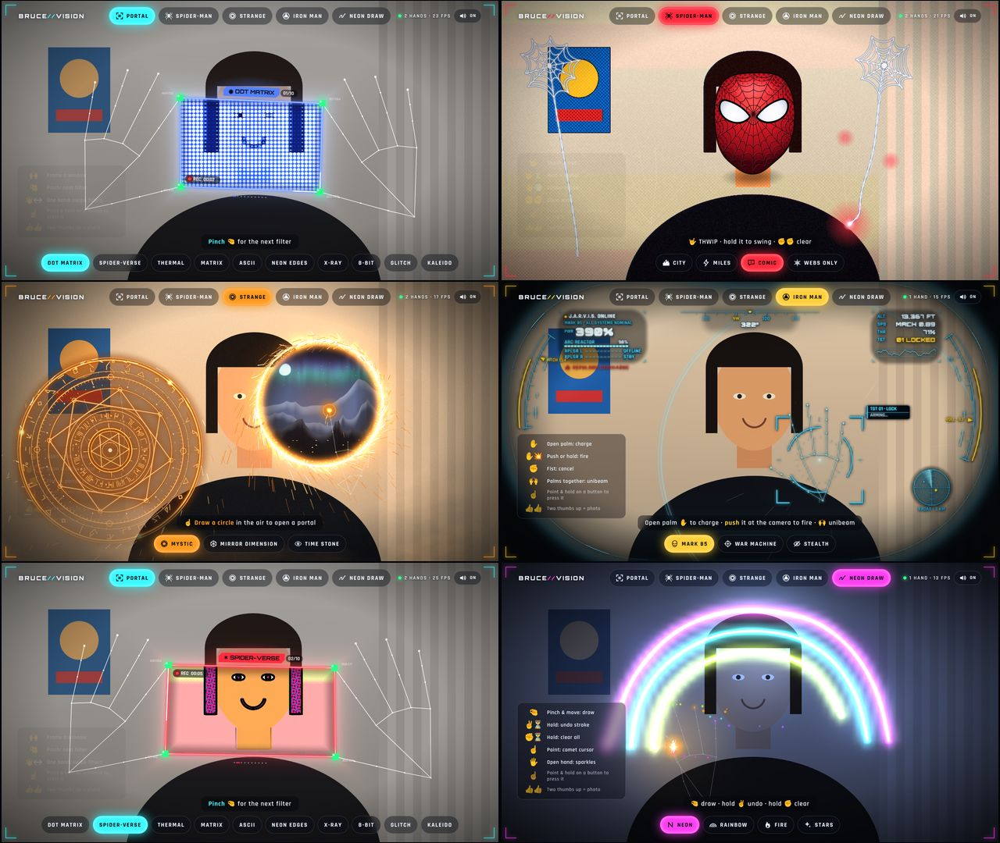

# BRUCE//VISION — hands-free AR effects

Control everything with your hands in front of the camera. **No keyboard, no
mouse, no touching the screen.** Frame a filter window with two hands, shoot
Spider-Man webs, cast Doctor Strange shields, fire Iron Man repulsors, or draw
with neon light in the air.



## Start

1. Open the page (see [Put it online](#put-it-online-github-pages)). Use a
   phone, tablet or computer with a camera.
2. Tap **START CAMERA** once and allow the camera. Browsers require that
   one tap; after that everything is hand gestures.
3. Stand back a little so your hands are in the picture.

Works in Chrome, Edge and Firefox on computers, Safari on iPhone/iPad
(iOS 16 or newer) and Chrome on Android. The page must be opened over
`https://` (or `localhost`) for the camera to work.

## Gestures

**Everywhere**

| Gesture | What it does |
| --- | --- |
| ☝️ Point at a button and hold (≈0.6 s) | Press it: modes along the top, options along the bottom |
| 🤏 Pinch on a button | Press it right away |
| 👍👍 Two thumbs up | Take a photo. Point at the photo to save it |

**PORTAL** (the effect from the viral clip)

| Gesture | What it does |
| --- | --- |
| 🙌 Raise both hands | The thumbs and index fingers become the 4 corners of a window, and everything inside it is filtered |
| 🤏 Pinch with either hand | Next filter |
| 👋 One hand, quick swipe left / right | Next / previous filter |

Filters: Dot Matrix (the blue halftone from the clip), Spider-Verse,
Thermal, Matrix, ASCII, Neon Edges, X-Ray, 8-Bit, Glitch, Kaleido.

**SPIDER-MAN** 🕷️

| Gesture | What it does |
| --- | --- |
| 🤟 Web-shooter sign (index + pinky out) | **THWIP!** Shoots a web where your hand points |
| Keep holding 🤟 | The web stays attached, so you can swing it around |
| Drop the sign | The web lets go and dangles |
| ✊✊ Both fists for half a second | Clear all webs |
| Move a hand fast near your head | Spider-sense tingle |

You also wear a Spider-Man mask that follows your face, and its eyes squint
when you blink. Options: **CITY** (Spider-Verse New York behind you),
**MILES** (Miles Morales suit, night city), **COMIC** (comic-book look, real
background), **WEBS ONLY**.

**DOCTOR STRANGE** ✺

| Gesture | What it does |
| --- | --- |
| ✋ Open palm | A spinning eldritch shield on your hand |
| ☝️ Draw a circle in the air with your index finger | Opens a sparking sling-ring portal to another world |
| ✊ Fist near a portal | Closes it |

Options: **MYSTIC**, **MIRROR DIMENSION** (the room behind you folds into a
kaleidoscope), **TIME STONE** (green, with time echoes).

**IRON MAN** ◉

| Gesture | What it does |
| --- | --- |
| ✋ Open palm | Charges a repulsor |
| Push your palm toward the camera (or keep holding it) | **Fire!** |
| ✊ Fist | Cancel the charge |
| 🙌 Both palms close together for 1 s | Unibeam |

Options: **MARK 85**, **WAR MACHINE**, **STEALTH**.

**NEON DRAW** 〰

| Gesture | What it does |
| --- | --- |
| 🤏 Pinch and move | Draw with light |
| ✌️ Hold | Undo the last line |
| ✊ Hold | Clear everything |
| 🖐️ Open hand | Sparkles from your fingertips |

Brushes: **NEON**, **RAINBOW**, **FIRE**, **STARS**.

Tip: links can open a mode and option directly, e.g. `index.html#spider` or
`index.html?opt=miles#spider`.

## Put it online (GitHub Pages)

1. In this repository on GitHub: **Settings → Pages**.
2. Under *Build and deployment*, choose **Deploy from a branch**, branch
   **main**, folder **/ (root)**, then **Save**.
3. After a minute or two the app is at
   `https://gaojiaxuan2-stack.github.io/Bruce-the-frist/bruce-vision/`.
   Open that on your phone.

## Run it on your computer

Any static web server works. For example, from the repository root:

```sh
python3 -m http.server 8000
```

Then open <http://localhost:8000/bruce-vision/>.

## Privacy

Everything runs on your device. The camera picture is processed in your
browser and is never uploaded. Photos are only saved if you point at
**SAVE**.

## How it works

- **Hand, face and body tracking:** [MediaPipe Tasks Vision](https://ai.google.dev/edge/mediapipe/solutions/vision/hand_landmarker)
  (Apache-2.0). The library, its WebAssembly runtime and the models are
  stored in this folder (`lib/`, `models/`), so it needs no CDN and works
  where Google servers are blocked. Face and body models load only when a
  mode needs them.
- **Gestures** (`js/gestures.js`): smoothed landmarks, then finger
  bend angles in 3D, which give the poses (✋ ✊ ☝️ ✌️ 🤟 👍), pinch and swipes.
- **Effects:** WebGL2 shaders for camera filters (`js/gfx.js`) and a 2D
  canvas for webs, sparks and HUDs. Each mode is one file plus helpers in
  `js/modes/`; see [`js/modes/README.md`](js/modes/README.md) to add your own.
- **Sound** is synthesized live with WebAudio (no audio files).

## Testing without a camera

Add `?sim=<mode>:<scenario>` to the URL to replace the camera hands with
scripted ones, e.g. `index.html?sim=spider:thwip` or
`index.html?sim=portal:frame&opt=verse`. Each mode lists its scenarios in
`simScenarios`. `dev/shoot.mjs` takes headless-Chromium screenshots
(needs Playwright): `node dev/shoot.mjs --url "index.html?sim=neon:draw" --out /tmp/neon`.

## Credits

MediaPipe © Google (Apache-2.0). Fonts Bangers, Rajdhani and Orbitron
(SIL Open Font License, `assets/fonts/OFL.txt`). Spider-Man, Doctor Strange
and Iron Man are Marvel characters. This is a non-commercial fan tribute.
